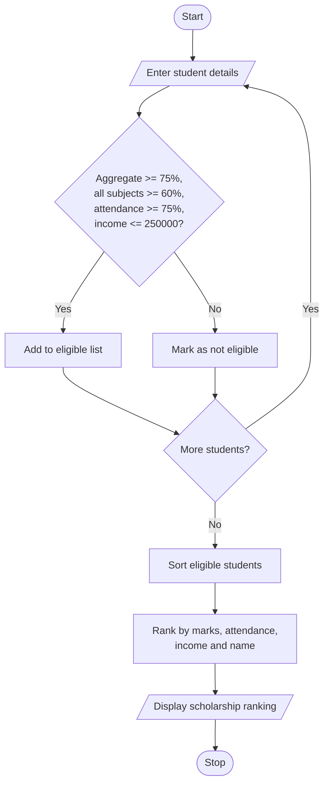

# 1. Problem Statement
Develop a Python program to allocate university scholarships based on students' aggregate marks, subject-wise minimum marks, attendance percentage, and family income. The system identifies eligible students, ranks them according to their aggregate marks, and resolves ties using predefined rules such as higher attendance and lower family income.
# 2. Algorithm
1. Start the program.
2. Read the number of students.
3. Enter each student's name, aggregate marks, subject marks, attendance percentage, and annual family income.
4. Check the eligibility criteria:
   - Aggregate marks ≥ 75%
   - Minimum mark in every subject ≥ 60%
   - Attendance ≥ 75%
   - Annual family income ≤ ₹2,50,000
5. Add eligible students to the scholarship list.
6. Rank students by:
   - Higher aggregate marks first.
   - If marks are equal, higher attendance first.
   - If both are equal, lower family income first.
   - If still tied, alphabetical order of name.
7. Display the eligible students and their ranks.
8. Display a message if no students are eligible.
9. Stop the program.
# 3. Flowchart (Mermaid)

# 4. Source Code (Python)

students = []
n = int(input("Enter number of students: "))

for i in range(n):
    print("\nStudent", i + 1)
    name = input("Enter name: ")
    aggregate = float(input("Aggregate marks (%): "))
    subjects = list(map(float, input(
        "Enter 3 subject marks: ").split()))
    attendance = float(input("Attendance (%): "))
    income = float(input("Annual family income (Rs): "))

    if (aggregate >= 75 and min(subjects) >= 60
            and attendance >= 75 and income <= 250000):
        students.append({
            "name": name,
            "marks": aggregate,
            "attendance": attendance,
            "income": income
        })

# Rank by marks, attendance, income, then name
students.sort(key=lambda s: (
    -s["marks"], -s["attendance"],
    s["income"], s["name"].lower()
))

print("\n--- SCHOLARSHIP RESULTS ---")

if students:
    for rank, s in enumerate(students, 1):
        print(f"{rank}. {s['name']} | "
              f"Marks: {s['marks']}% | "
              f"Attendance: {s['attendance']}% | "
              f"Income: Rs.{s['income']:.0f}")
else:
    print("No eligible students found.")
# 5. Sample Input
Enter number of students: 3

Student 1
Enter name: Ravi
Aggregate marks (%): 85
Enter 3 subject marks: 80 90 75
Attendance (%): 90
Annual family income (Rs): 180000

Student 2
Enter name: Kiran
Aggregate marks (%): 85
Enter 3 subject marks: 70 80 85
Attendance (%): 95
Annual family income (Rs): 200000

Student 3
Enter name: Sita
Aggregate marks (%): 68
Enter 3 subject marks: 65 70 60
Attendance (%): 80
Annual family income (Rs): 150000
# 6. Sample Output
--- SCHOLARSHIP RESULTS ---
1. Kiran | Marks: 85.0% | Attendance: 95.0% | Income: Rs.200000
2. Ravi | Marks: 85.0% | Attendance: 90.0% | Income: Rs.180000

# 7. Output Screenshot

